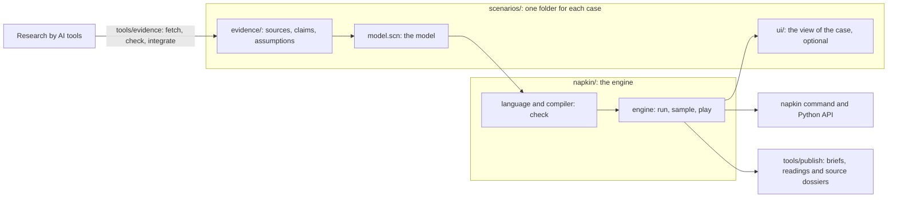
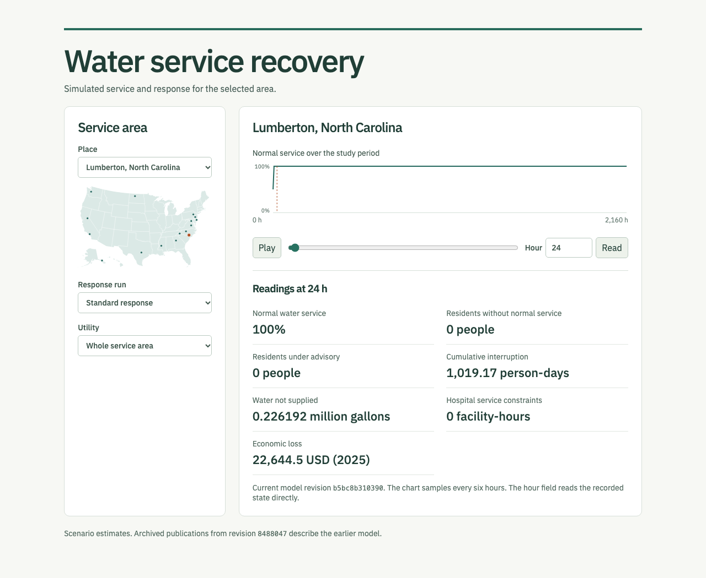

# napkin

`napkin` is a Fermi calculation engine for complex events. It calculates how an event develops and
what it causes, from a set of basic facts about the event. AI research tools find those facts and
their sources. `napkin` puts the facts into one model that you can audit. Each number has a unit and
its source. The compiler checks that the numbers fit together, and each result traces back to the
facts behind it.

The catalogue studies hypothetical AI uplift in strategic cyber operations. It also studies how the
timing of incidents and the response policies change water, electricity and IV-fluid service. The
engine also runs models of other subjects.



## Why it exists

Some questions have no data set that answers them. What happens to a city if an AI agent wipes the
controls of its water systems? An answer needs many small facts. How much water does the city store?
How fast do repair crews work? How long does the attacker keep its access?

AI tools can now find such facts quickly, with their sources. `napkin` is the place where those facts
meet:

- **A typed model** holds each fact with its unit and its support.
- **The evidence** keeps each fact as a claim, with the source, the place in the source and the words
  that it quotes. The evidence tools check those words against the text of the source.
- **The engine** calculates the facts forward in time and gives the results.

The result is an estimate that you can audit, not a number that you must trust. Change a fact, and
see which results change.

## What is here

- **The engine**, in `napkin/`: the language, the compiler, the engine and the command. The wheel
  `napkin-sim` holds this folder only.
- **The catalogue**, in `scenarios/`: four packages for water service, electricity restoration during
  heat, IV-fluid supply and strategic cyber AI uptake. Each package holds its model, its evidence and
  its tests. A package can also hold a dashboard or a notebook.
- **The examples**, in `examples/`, and the tools of the maintainers, in `tools/`. The tools include
  the evidence tools and the publisher.

## Principles

- **Each number has a unit and a support:** a source, an identity, a convention or a stated
  assumption.
- **Each fact has its source.** A number from a source cites a claim, and the claim gives the place
  in the source.
- **Check before you run.** The compiler checks each unit, each type and each range before a run.
- **Each result traces** to the values and the evidence behind it.
- **A model states only what it can estimate.** It says in its evidence why it leaves out an outcome.
  A run that cannot answer stops with a named failure.
- **Results are not forecasts.** They are estimates under stated assumptions that you can change. A
  range is a chosen bound, not a measured interval.
- **Tests use independent mathematics**, not the answers of the engine itself.
- **The engine stays general and small.** What belongs to one case stays in its folder: its evidence,
  its tests and its view.

## A case that shows itself



The water case follows service and recovery in 16 places after a controls outage. Select a place and
a response. Then follow the stored water, the repair work that stays and the service, hour by hour.
The dashboard needs Node.js 20 or later:

```sh
python -B -m scenarios.water_controls_wipe.ui setup
python -B -m scenarios.water_controls_wipe.ui serve
```

## Start

`napkin` needs Python 3.12 or later. Install it from a checkout. The PyPI project `napkin` is a
different tool.

```sh
python3 -m venv .venv
.venv/bin/python -m pip install .
.venv/bin/napkin run examples/piano_tuners
```

[The modeling guide](docs/modeling-guide.md) builds a first model step by step.

## Documentation

| Document | What it tells you |
| --- | --- |
| [docs/README.md](docs/README.md) | The list of all pages of the documentation, in the order to read them |
| [docs/modeling-guide.md](docs/modeling-guide.md) | How to write a model and check it, step by step |
| [docs/language/README.md](docs/language/README.md) | Each line of the model language, and the terms of the documentation |
| [docs/language/changes.md](docs/language/changes.md) | Each word of the old language, and what replaced it |
| [docs/cli.md](docs/cli.md) | Each command, flag and output of `napkin` |
| [docs/python-api.md](docs/python-api.md) | How to compile, run, read, play and study a model from Python |
| [docs/engine/README.md](docs/engine/README.md) | How the engine calculates a run |
| [docs/compiler.md](docs/compiler.md) | How the compiler reads and checks a model |
| [docs/draw.md](docs/draw.md) | The static picture of a model, `napkin draw` |
| [docs/design/README.md](docs/design/README.md) | The principles of the design, and the rulings of the owner |
| [docs/known-issues.md](docs/known-issues.md) | The known issues, and the features that can come next |
| [scenarios/README.md](scenarios/README.md) | The packages of the catalogue, with their questions and results |
| [scenarios/docs/catalogue.md](scenarios/docs/catalogue.md) | The rules of the catalogue |
| [scenarios/docs/evidence/README.md](scenarios/docs/evidence/README.md) | How the catalogue records its evidence |
| [scenarios/docs/deviations.md](scenarios/docs/deviations.md) | How the current policies, units and outputs compare with the earlier catalogue |
| [scenarios/docs/recovery-ports.md](scenarios/docs/recovery-ports.md) | The baselines, the inputs and the historical comparisons of each recovery port |
| [scenarios/water_controls_wipe/ui/README.md](scenarios/water_controls_wipe/ui/README.md) | The live view of the water case |
| [scenarios/heat_wave_blackout/explore.ipynb](scenarios/heat_wave_blackout/explore.ipynb) | A notebook that runs the heat-wave case with values that you choose |
| [CONTRIBUTING.md](CONTRIBUTING.md) | How to work on `napkin`: the setup, the rules of a change, the tests and the writing standard |
| [CHANGELOG.md](CHANGELOG.md) | The releases |

## License and citation

The software and the documentation are under the [MIT license](LICENSE.txt). Cite `napkin` with
[CITATION.cff](CITATION.cff). [ASSET_NOTICES.md](ASSET_NOTICES.md) gives the rights of the quoted
sources. Use the [project issues](https://github.com/jfeiglin/napkin/issues) for questions and
corrections.
