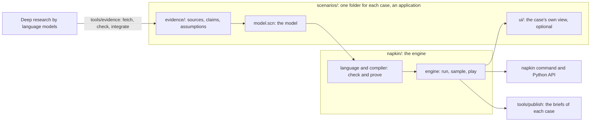

# napkin

`napkin` is a Fermi calculation engine for complex events. It simulates how an event unfolds and what
it causes, from a set of basic facts about the event. Language models research those facts in depth,
and `napkin` puts them into one framework that you can attest. Each number has a unit and its source,
the compiler checks that the numbers fit together, and each result traces back to the facts behind it.

It started as a way to simulate the outcomes of adverse cyber events, and the cases in this repository
are of that kind. The engine itself is general: it knows nothing of cyber.



## Why it exists

Some questions have no data set that answers them. What happens to a city if an AI agent wipes the
controls of its water systems? An answer must be built from many small facts. How much water does the
city store? How fast do repair crews work? How long does the attacker keep its access?

Language models can now find such facts quickly, with their sources. `napkin` is where those facts
meet:

- **A typed model** holds each fact with its unit and its basis.
- **The evidence** keeps each fact as a claim, with the source, the place in it and the words that it
  quotes. The evidence tools check those words against the source's text.
- **The engine** runs the facts forward in time and gives the outcomes.

The result is an estimate that you can audit, not a number that you must trust. Change a fact, and see
which results move.

## What is here

- **The engine**, in `napkin/`: the language, the compiler, the engine and the command. The wheel
  `napkin-sim` ships this package only.
- **The applications**, in `scenarios/`: four cases of adverse cyber events that use the engine. Each
  case holds its model, its evidence, its tests and its briefs. A case can also bring its own view.
- **The examples**, in `examples/`, and the maintainer tools, in `tools/`, which include the evidence
  tools.

## Principles

- **Each number has a unit and a basis:** a source, an identity, a convention or a stated assumption.
- **Facts are attested.** A sourced number cites a claim, and the claim records where its source says it.
- **Check before you run.** The compiler checks each unit and range, and it proves the model's checks.
- **Each result traces** to the values and the records behind it.
- **"Not estimated" is not zero.** An outcome that a model does not calculate says so. A numerical failure
  invalidates the run.
- **Results are not forecasts.** They are estimates under stated assumptions that you can edit. A range is
  a chosen bound, not a measured interval.
- **Tests use independent mathematics**, not the solver's own answers.
- **The engine stays general and small.** What belongs to one case stays in its folder: its evidence, its
  tests and its view.

## A case that shows itself


The water case follows an attack on the water systems of 16 real places. Pick a place and a run, and
the engine calculates it. Then play the story hour by hour. The view needs Node.js 20 or later:

```sh
python -B -m scenarios.water_controls_wipe.ui setup
python -B -m scenarios.water_controls_wipe.ui serve
```

## Start

`napkin` needs Python 3.12 or later. Install it from a checkout: the PyPI package `napkin` is a different
tool.

```sh
python3 -m venv .venv
.venv/bin/python -m pip install .
.venv/bin/napkin run examples/piano_tuners
```

## Documentation

| Document | What it tells you |
| --- | --- |
| [docs/cli.md](docs/cli.md) | Each command, flag and output of `napkin` |
| [docs/language.md](docs/language.md) | Each line of the model language |
| [docs/modeling-guide.md](docs/modeling-guide.md) | How to design a model and check it |
| [docs/python-api.md](docs/python-api.md) | How to load, run, sample and play a model from Python |
| [docs/engine.md](docs/engine.md) | How the engine runs a model |
| [docs/compiler.md](docs/compiler.md) | How the compiler reads, checks and proves a model |
| [docs/design.md](docs/design.md) | The design, and what it was measured to do |
| [docs/extending.md](docs/extending.md) | What to change for a new feature |
| [docs/draw.md](docs/draw.md) | The static picture of a model, `napkin draw` |
| [docs/known-issues.md](docs/known-issues.md) | The known issues, and the features that could come next |
| [scenarios/README.md](scenarios/README.md) | The briefs of the four cases, with their results and evidence |
| [scenarios/docs/catalogue.md](scenarios/docs/catalogue.md) | How the cases are written |
| [scenarios/docs/evidence/README.md](scenarios/docs/evidence/README.md) | How the evidence is recorded |
| [scenarios/water_controls_wipe/ui/README.md](scenarios/water_controls_wipe/ui/README.md) | The live view of the water case |
| [scenarios/heat_wave_blackout/explore.ipynb](scenarios/heat_wave_blackout/explore.ipynb) | A notebook that runs the heat-wave case with values that you choose |
| [CONTRIBUTING.md](CONTRIBUTING.md) | How to work on `napkin`: the setup, the checks, the tests and the writing style |
| [CHANGELOG.md](CHANGELOG.md) | The releases |

## License and citation

The software and the documentation are under the [MIT license](LICENSE.txt). Cite `napkin` with
[CITATION.cff](CITATION.cff). [ASSET_NOTICES.md](ASSET_NOTICES.md) gives the rights of the quoted sources.
Use the [project issues](https://github.com/jfeiglin/napkin/issues) for questions and corrections.
