# The picture of a model

`napkin draw` draws a static picture of a model as one SVG file. The picture shows each thing of the
model with its stocks, its flows and its state machines. Arrows show what each thing reads, changes,
starts and moves of the others. The picture is a check of the model: when an arrow surprises a
reader, the model is wrong. The optional file `style.toml` places, groups, hides and labels the
things, and gives their icons and their roles. No run reads it. The words **model**, **package**,
**variant**, **entity**, **template**, **instance**, **stock**, **flow**, **event** and **named run**
have the meanings of [the terms](language/README.md#terms).

## Contents

1. [An example](#an-example)
2. [What the picture shows](#what-the-picture-shows)
3. [How the layout works](#how-the-layout-works)
4. [The command](#the-command)
5. [style.toml](#styletoml)
6. [Roles: `[role]` and `roles.toml`](#roles-role-and-rolestoml)

## An example

```text
$ napkin draw examples/reservoir -o docs/draw-example.svg
docs/draw-example.svg: 2 things, 2 arrows
```



The model `examples/reservoir/model.scn` has two entities. Its `style.toml` places them, gives the
reservoir an icon and the operator a role, shows the rule of the operator's event, and turns on the
panels of the reservoir:

```toml
[layout]
card_width = 300   # wide enough for the names of the two tallies

[place]
operator  = { column = 1 }
reservoir = { column = 2 }

[icon]
drop = ["reservoir"]

[role]
operator = ["operator"]

[triggers]
rules = ["operator"]
lines = 3          # the whole rule of the choice

[equations]
things = ["reservoir"]
width  = 640

[references]
show = true
```

The file also gives the symbols of the equations in `[symbol.reservoir]` (`water = "W"`,
`storm = "q_in"`, and others). The picture shows these parts:

- **The title and the subtitle.** The title is the scenario's title, "A reservoir in a storm". The
  subtitle gives the name of the package, `reservoir`, and how long a run lasts, 5 days.
- **The operator** is in column 1. `[role]` gives it the role `operator`, and `[icon]` names no icon
  for it, so its card has the icon of its role, `server`. Its row of events (`[triggers] rules`)
  gives the rule of `decide` in words: "decide — when water is at least level, once; after 0 h:
  sets order, by order, open: sets gate".
- **The reservoir** is in column 2, with the icon `drop`. Its stock, the water in the reservoir, is
  the blue row. The storm fills it: the teal pipe comes from outside the model, the small circle.
  The two yellow rows are tallies: the water let out over the spillway, and the time with the water
  above the risk level. The flows into the tallies are in the tooltips of their rows. Each row
  carries its symbol, `W`, `S` and `T`.
- **The spillway** is a stored enum value of the reservoir (`gate: enum[CLOSED, OPEN]`), so its
  state machine is in the card. The green dot marks the state at the start, `CLOSED`. Transition 1 goes
  from any state to `OPEN`. The key under the machine says "1 decide, by Operator".
- **The arrows.** The grey dotted arrow goes from the reservoir to the operator: the operator reads
  the water. The red dashed arrow goes from the operator to the reservoir: the operator sets the
  gate.
- **The legend** shows only the marks that the picture draws.
- **The panels** under the legend give the equations of the reservoir, a table of their symbols, and
  the references. Each equation comes from the model's own expressions. The small numbers point to
  the references. Here, most numbers are assumptions of the example.

## What the picture shows

The picture has a title, a subtitle, the cards, the arrows, the frames of the groups, a legend and
the optional panels. Each part has a tooltip: in a browser, point to a part to see its name in the
model and its details. The picture does not need the tooltips. What a stylesheet turns on shows in
the picture itself, also as an image on a page or in a PDF.

**The subtitle** names the package (and the variant) and the run. With `--run`, it gives the name of
the run and its label, and the options when the label does not name them. Without `--run`, it says
"all n runs" when the picture joins several runs. It says how long a run lasts. It names the things
that `[layout] hide` leaves out ("not drawn: …").

**Cards.** Each thing is a card. A thing is one of these:

- an entity (`tank:`);
- an instance that the model writes by hand (`north: Utility`);
- a table (`sites: Place from "places.csv"`). Its rows share one card, with a badge `×k`, the number
  of rows.

A template has no card of its own: its instances stand for it. The values of the top level are on
no card. A card shows its title, on two lines at most, and its icon.

**Kinds of values.** The picture gives each value its kind by its use. A stored number at an end of a
flow, a leg, a route or a `move` is a stock. A stock that nothing takes from is a tally. Another
stored value that a statement assigns, or that a solver solves for, is a state.

**Stocks, tallies and flows.** A card shows its stocks as blue rows and its tallies as yellow rows
with a gauge. It shows four rows at most (`[layout] stocks`): the stocks first, then those with more
pipes. `[stocks]` can name the rows and their order. A row "+n" stands for the others. A flow between
two stock rows of one card, or between a stock row and the outside of the model, is a teal pipe with
a valve. The flows between the same two ends are one pipe, which shows their number. A flow into a
tally, or into a stock that the card does not show, is in the tooltip of its row. A flow to or from
another card is an arrow of the kind "moves".

**State machines.** Each stored enum value of a thing is a small state machine: a pill for each
state, and a green dot on the state at the start. Each event that sets the value is a
purple transition. It starts from the states in which the event can start, or from "any state". A
number on each transition names it in the key under the machine. When an option sets the start of
the value, the key says "Options set the start: …". A machine with at most 4 states and 6 transitions
is inside its card. A larger machine is beside the card, below it in the same column.

**Events.** `[triggers]` shows the events of a card at the bottom of the card, in plain words that
come from the model ([`[triggers]`](#triggers-the-events-of-a-card)). The words are the names of the
event and of the values that it reads, so better names in the model give better rows. No card shows
its events without `[triggers]`.

**Arrows.** One arrow joins two cards for each kind of link between their parts. A part is a formula,
the start value or the bounds of a value, a member's own value, the settings of an endpoint, a flow,
an event or a solver. Assertions are no parts: no run reads them.

| Kind | What a part of one card does | The head of the arrow is at | Drawn as |
| --- | --- | --- | --- |
| Reads | It reads a value of the other card | The card that reads | A grey dotted line, an open head |
| Follows | It reads when an event of the other card started (`since`, `count`) | The card that reads | A purple dashed line, an open circle |
| Changes | It sets, adds to or takes from a value of the other card, shares out its flow, or solves for it | The card whose value changes | A red dashed line, a filled head |
| Fires | A statement of its event starts an event of the other card | The card whose event starts | An orange dash-dot line, a head with a bar |
| Moves | It moves material into or out of a stock of the other card, with a flow or a `move` | The card whose stock changes | A thick blue line, a filled head |

Two kinds always differ in their width, their dashes or their head, so they differ without color
too. The tooltip of an arrow names the values that it stands for.

- **Light and hidden.** `[arrows]` gives each kind a look: full, light or hidden. A light arrow is
  paler and thinner. A hidden kind draws no arrow, and the legend says "not drawn". Without
  `[arrows]`, reads and follows are light, and the other kinds are full.
- **Bundles.** The arrows of one kind from one card toward one side share one line, the trunk, and
  branch near the cards at their ends. A small dot marks each branch. Without `[arrows] bundle`,
  reads and follows bundle.
- **Point at a card.** In a browser that knows the CSS selector `:has()`, the arrows of a card stand
  out when a reader points at the card. The SVG has no script for this.

**Panels.** `[equations]` puts panels under the legend, for the things that it names.

- **Equations.** For each thing: the balance of each stock (dS/dt = what flows in − what flows out),
  the rate of each flow, its bounds, and the formulas that the rates read, as many hops deep as
  `depth` says. Other lines give the changes that events make at once (`G ← OPEN at decide, open`).
  A line that does not fit ends with "… (continues in the LaTeX)". Each line keeps its LaTeX in an
  attribute `data-latex`.
- **Symbols.** Each symbol of the lines, with its meaning, its unit, its value and, for an input,
  its chosen range and its distribution. A chosen range is the range that a reader can set. It is
  not a measured interval, and a note under the table says so.
- **References.** With `[references] show`, the lines and the inputs carry small numbers, and a
  numbered list says where they come from. Each entry starts with its kind: a source, a source
  applied here, an identity, a convention, or an assumption with its review status. The color of a
  number shows its kind too. No entry shows the ID of a `record` declaration.

**Icons.** A card has the icon that `[icon]` gives it, else the icon of its template, else the icon
of its role, else none ([`[icon]`](#icon-the-icons)). A card with no icon keeps the place of the icon
free.

**Light and dark.** The SVG file has no script, no external font and no image. CSS custom properties
give its colors, and a `prefers-color-scheme: dark` rule changes them. Each element also has its
light color as an attribute, for a reader that does not know CSS custom properties.

## How the layout works

The same model, stylesheet and run give the same bytes.

1. **Places and groups first.** A card that `[place]` places takes its column. A row orders it among
   the cards of its column. The members of a group are one block in each column, in the order of
   `[group]`.
2. **Layers.** The drawn arrows of the kinds "changes", "fires" and "moves" place the other cards.
   Each card goes in the column after the latest card that changes it, starts its events or moves
   its material. The layout breaks a cycle of arrows first. A card with only "reads" and "follows"
   arrows takes the middle column of the cards that it reads or that read it. A card with no arrow
   takes the last column.
3. **Columns.** A column holds 8 cards at most (`[layout] cards_per_column`). A fuller column splits
   into the fewest columns that hold it. A column with no card takes no room.
4. **Fewer crossings.** Sweeps over the columns order the cards of each column by the positions of
   the cards that they join. Of 24 sweeps, the order with the fewest crossings wins.
5. **Orthogonal arrows.** An arrow goes horizontally from its card, vertically on a track in the gap
   between two columns, and horizontally to the other card. Each gap is as wide as its tracks need.
6. **Groups.** A group is a frame with its label around its members only. The other cards of its
   columns go above or below it.

## The command

```text
napkin draw [-h] [--run NAME] [--style FILE] [-o FILE] [--latex FILE] MODEL
```

| Flag | What it does |
| --- | --- |
| `--run NAME` | Draw the named run NAME. Leave out the events that cannot start in it, with their lines and arrows |
| `--style FILE` | Use FILE in place of `style.toml` |
| `-o FILE` | Write the SVG to FILE. Without it, `<package>[.<variant>][.<run>].svg` in the current folder |
| `--latex FILE` | Also write the equations, the symbols and the references of `[equations]` as a LaTeX fragment. It needs the packages `amsmath`, `longtable` and `hyperref`, in this order |

MODEL is a package folder or its `model.scn`. A variant is the folder of the variant or its
`model.scn`. The runs of a model are its named runs, else its default run. Without `--run`, a model
with one named run is drawn as that run. A model with several named runs is drawn with its runs
joined: the picture draws each event that can start in one of them. `program/reach.py` proves which
events cannot start in a run ([compiler.md](compiler.md#proofs-over-a-program)).

```text
$ napkin draw examples/incident_response_tempo --run recovery_linked
incident_response_tempo.recovery_linked.svg: 3 things, 8 arrows
```

The LaTeX fragment has the same equations, symbols, ranges and references as the picture. Each block
of equations is an `align*` with `\allowdisplaybreaks[1]`. The symbols are a `longtable`. A picture
taller than a PDF page holds (19,200 px) gets a note: show fewer things in `[equations] things`, or
use `--latex`.

```text
$ napkin draw examples/reservoir -o reservoir.svg --latex reservoir.tex
reservoir.svg: 2 things, 2 arrows
reservoir.tex: 1 block, 10 symbols, 9 references
```

The command and its exit codes are also in [cli.md](cli.md#napkin-draw).

## style.toml

`style.toml` is an optional TOML file. It changes only the picture. No run reads it, and the model
hash does not cover it, so a change to it keeps every result and every saved edit document. Its
tables are `[layout]`, `[place]`, `[group]`, `[icon]`, `[role]`, `[state.<thing>]`, `[stocks]`,
`[arrows]`, `[triggers]`, `[equations]`, `[references]`, `[symbol.<thing>]` and `[subscript]`. Each
table is optional, and so is each key of a table.

A name in the file is a thing or a template. A thing is an entity, an instance that the model writes
by hand, or a table. A template stands for each of its instances. A thing's own setting wins over
its template's.

### Where the file is

`napkin draw` and `napkin compile` use the first file of this list:

1. the file that `--style FILE` names (`napkin draw` only);
2. `style.toml` in the folder of the variant, for a variant;
3. `style.toml` in the folder of the package.

The file that they find is the whole picture: a variant's own file replaces its package's file, and
the two never merge. Without a file, nothing is hidden, placed or grouped, and no card has an icon.

### `[layout]`

| Key | What it gives | Without it |
| --- | --- | --- |
| `direction` | The direction of the picture. Its one value is `"left-to-right"` | `"left-to-right"` |
| `hide` | The things and templates that the picture leaves out, with their arrows and transitions. A template hides each of its instances. The subtitle names them | Nothing hidden |
| `stocks` | The most stock and tally rows of a card before its "+n" row, a whole number from 1 to 8 | 4 |
| `cards_per_column` | The most cards of a column, a whole number from 2 to 16 | 8 |
| `card_width` | The least width of a card in px, a whole number from 170 to 400. A card whose title, rows or machines need more is wider | 170 |

### `[place]`

`name = { column = c, row = r }` places a thing or a template. `column` counts from 1 and is
required. `row` counts from 1, in the column, and is optional.

- A placed card takes its column. A column with no card takes no room.
- A row orders a card among the cards of its column. Two cards never have one column and one row.
- A template with a row places its instances on that row and on the rows that follow it, in the
  order of the model.

### `[group]`

`"Label" = [name, …]` draws a frame with its label around these things and no other thing. A thing is
in one group at most. `napkin compile` refuses two cases: a thing with a row between the rows of two
things of a group that it is not in, and a thing of a group with a row above a thing of an earlier
group, in one column.

### `[icon]`: the icons

`icon = [name, …]` gives these things and templates the icon. A name has one icon at most. An
instance's own icon wins over its template's icon, and the template's icon wins over the role's
icon. A card that no line of `[icon]` names has the icon of its role, from this table. A card with
another role, or with no role, has no icon.

| Icon | For | The icon of the role |
| --- | --- | --- |
| `target` | An attacker | `adversary` |
| `server` | Computer systems and services | `operator` |
| `shield` | Responders and defenders | `responder` |
| `hospital` | Hospitals, clinics and care | `clinician` |
| `people` | People and teams | `community` |
| `gauge` | Controls and conditions | `environment` |
| `factory` | Plants and makers | |
| `tank` | Stores of a liquid or a gas | |
| `pipe` | Pipelines | |
| `bolt` | Electric power | |
| `drop` | Water | |
| `wrench` | Repair crews | |
| `truck` | Transport and deliveries | |
| `box` | Stocks of goods and parts | |
| `document` | Records, claims and changes | |
| `money` | Payments and the economy | |
| `house` | Homes and buildings | |
| `shop` | Shops and businesses | |
| `sun` | Weather and heat | |
| `alert` | Hazards | |

### `[role]`: who plays each thing

`role = [name, …]` says who plays these things and templates. A role is a word, such as `operator`.
A card takes the icon of its role when `[icon]` gives it none. A thing plays one role at most, by its
own name or by its template's. `[role]` can name a thing that `[layout] hide` hides, because who
plays a part is no part of the picture. [Roles](#roles-role-and-rolestoml) says why the role is here
and not in the model.

```toml
[role]
operator = ["operator"]
environment = ["reservoir"]
```

With this table, the reservoir keeps the icon `drop`, because `[icon]` names it. The operator takes
the icon `server` of its role.

### `[state.<thing>]`

`[state.reservoir]` with `gate = "beside"` says where the state machine of the enum value
`reservoir.gate` goes. The table names a thing or a template that the picture draws. Each key is one
of its stored enum values.

| Value | Where the machine goes |
| --- | --- |
| `"inside"` | In its card, when it has at most 4 states and 6 transitions; else beside the card. This is the default |
| `"beside"` | Beside its card, below it in the same column, joined to it by a dotted line |
| `"hidden"` | Nowhere: the picture does not draw it |

### `[stocks]`

`supply = ["water", "reserve"]` gives the stock and tally rows of the card of `supply`, in this
order. The card shows the first rows of the list, at most `[layout] stocks`. The "+n" row stands for
the others. A template's list goes to each of its instances, and an instance's own list replaces its
template's list.

### `[arrows]`

| Key | What it gives | Without it |
| --- | --- | --- |
| `reads`, `follows`, `changes`, `fires`, `moves` | The look of the arrows of that kind: `"full"`, `"light"` or `"hidden"` | `"light"` for reads and follows, `"full"` for the others |
| `bundle` | The kinds whose arrows from one card toward one side share one trunk, as a list such as `["reads", "follows"]`. An empty list bundles nothing | `["reads", "follows"]` |

A look is for a kind, not for one pair of cards. A hidden kind places no card: only the drawn arrows
decide the columns, so a hidden kind can move cards.

### `[triggers]`: the events of a card

Each level is a list of things and templates. A card shows the events of its thing at its level. A
thing's own level wins over its template's level, and a name is in one level at most.

| Key | What the card shows | Without it |
| --- | --- | --- |
| `count` | One row: "n events" | — |
| `names` | A row for the name of each event | — |
| `rules` | For each event, its name, then how it starts, its steps and the runs that leave it out, cut to `lines` rows | — |
| `hover` | Nothing: only the card's tooltip holds the events | — |
| `lines` | The most rows of one event at `rules`, a whole number from 1 to 4 | 2 |
| `events` | The most events with a row, a whole number from 1 to 20. A row "+n more" stands for the others | 6 |
| `options` | Whether the rows name the options that switch an event on or off: true or false | true |

At every level, the tooltip of the card holds the full line of each event. The words come from the
model: the names of the event and of the values that it reads, the units as the model writes them,
and a few words such as "when", "has passed since" and "is at most".

### `[equations]`: the equations of a card

| Key | What it gives | Without it |
| --- | --- | --- |
| `things` | The things and templates whose equations the panels show. Each thing makes the picture taller: name the 1 to 3 things whose stocks carry the story | No panels |
| `depth` | How many hops of formulas the lines follow from the rates, a whole number from 0 to 5 | 1 |
| `width` | The width of the panels in px, a whole number from 320 to 2400 | 720 |
| `lines` | The most rows of one equation, a whole number from 1 to 8 | 3 |
| `tags` | Whether each shown stock row carries its symbol: true or false | true |
| `symbols` | Whether the Symbols table shows: true or false | true |
| `checks` | Whether the lines show the assertions of the things: true or false | false |
| `instances` | `"together"`: the instances of a template with the same equations share one block; `"each"`: each instance has its own block | `"together"` |

### `[references]`

| Key | What it gives | Without it |
| --- | --- | --- |
| `show` | Whether the numbers and the References list show: true or false. It needs `[equations] things` | false |
| `kinds` | The kinds of entry that the list holds, from `"source"`, `"source_transfer"`, `"identity"`, `"convention"` and `"assumption"`. The list always keeps `"assumption"` | Every kind |

### `[symbol.<thing>]` and `[subscript]`

The equations write each value, flow and event with a short symbol, such as `W_s`. The picture makes
each symbol from the model's names. A stylesheet can set a symbol, for example to use the symbols of
a paper:

```toml
[symbol.reservoir]
water = "W"          # a value, a flow or an event of reservoir, exactly as written
spillway = "sigma"   # a Greek letter by its name

[subscript]
reservoir = "r"      # the subscript of the card of reservoir in the symbols that the picture makes
```

A symbol is a letter or a Greek name (such as `delta`), an optional `'`, and an optional `_` with a
subscript of letters, digits and commas. A thing's symbol is used exactly as written. A template's
symbol has no subscript: each instance adds its own. Two values never have one symbol, and two cards
never have one subscript.

### What `napkin compile` checks

`napkin compile` reads and checks the stylesheet of the model that it compiles, and `napkin draw`
checks the file that it uses. A problem stops both, with exit 1. Each problem names the file and the
key, and the line for a file that is not TOML. The checks:

- Each table and each key is one that this version reads, so a misspelled key shows.
- Each name is a thing or a template of the model. `[icon]`, `[place]`, `[group]`, `[state]`,
  `[stocks]`, `[triggers]` and `[equations] things` name only things that the picture draws.
- A role of `[role]` is a word, and a thing has one role at most.
- A list names each thing once. A thing has one icon and one group at most. Two things never have
  one column and one row.
- Each number is a whole number in its range, and each look, place and kind is one of its values.

For example, this stylesheet writes `hidden` in place of `hide`, the icon `water`, which is no icon,
and the look `faint`, which is no look:

```text
$ napkin draw examples/reservoir --style badstyle.toml -o x.svg
badstyle.toml: error: layout.hidden: is not a key that this file reads; it reads layout.direction, layout.hide, layout.stocks, layout.cards_per_column, layout.card_width [style]
badstyle.toml: error: icon.water: water is not an icon; the icons are target, server, shield, hospital, people, gauge, factory, tank, pipe, bolt, drop, wrench, truck, box, document, money, house, shop, sun, alert [style]
badstyle.toml: error: arrows.reads: is one of "full", "light", "hidden" [style]
```

A role that names no thing gives this diagnostic:

```text
badrole.toml: error: role.operator: operater is not a template or a thing [style]
```

## Roles: `[role]` and `roles.toml`

A model has no role. No entity, template, instance, event or case of a model says who plays it, and
the compiler refuses a role in a model by name, with where the role goes
([design/decisions.md](design/decisions.md), change 23). Who plays a part belongs to two files of the
package, outside the model:

| File | Who reads it | What it holds |
| --- | --- | --- |
| `style.toml`, table `[role]` | `napkin draw` and `napkin compile` | The role of each thing and template of the picture: `operator = ["operator"]` |
| `roles.toml` | The publisher and the user interface of a scenario (the wrapper). No command of `napkin` reads it | `[entities]`: the role of each entity and template, by name. `[events]`: the role of each event, by its path |

The `roles.toml` of `examples/reservoir`:

```toml
[entities]
operator = "operator"
```

A `roles.toml` of the catalogue can also give the role of an event:

```toml
[events]
"crews.repairs_start" = "utility"
```

No run, no hash and no record reads either file. So a change of a role changes no result.
