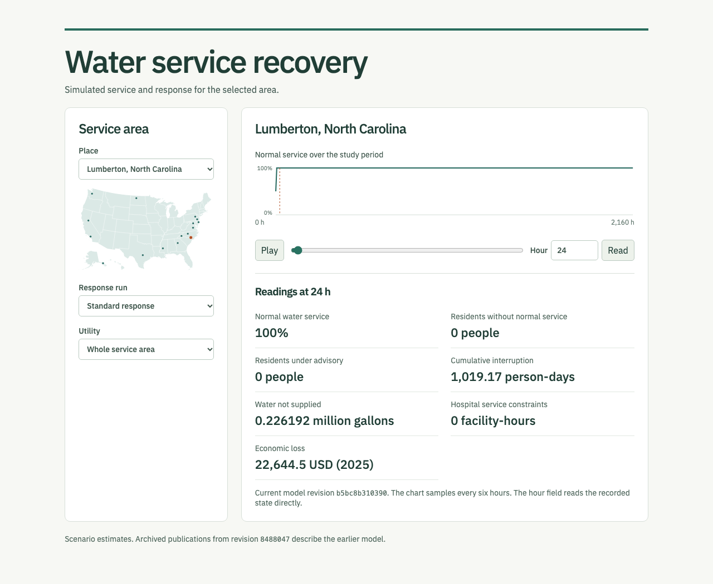

# Water service recovery dashboard

Select a place on the map or from the menu, choose an authored response run, and view its modeled service history. The whole-area view shows residents with interrupted service or an advisory, the volume of unmet demand and cumulative hospital service constraints. The regional support runs also show dispatch workload, supplemental water delivered and the household emergency-water deficit. Selecting one utility shows its service share and cumulative delivered water.

The chart and playback use six-hour observations. Enter a fractional hour and choose **Read** for a direct measurement at that time. Every value is read from the same completed engine Record for that run. Units and the model revision travel with the readings. A simulation that stops produces its diagnostic. Historical publications at `8488047` describe the earlier scenario.



## Start the dashboard

Use the repository's Python environment and Node.js 20 or later. From the checkout root, run

```sh
python -B -m scenarios.water_controls_wipe.ui setup
python -B -m scenarios.water_controls_wipe.ui serve
```

Open [the local dashboard](http://localhost:8765/). The server binds to the local computer. `--port` changes its port. `--jobs` sets the maximum worker count. Each place's program compiles once per worker. Requests for response runs are evaluated on demand and may reuse the run store. Use `dev` for live frontend reloads or `test` to run the frontend unit tests.

## Local API

| GET route | Result |
|---|---|
| `/api/places` | Available service areas |
| `/api/places/{place}` | Utility names, response options, horizon and program revision |
| `/api/places/{place}/runs/{run}` | Readings at six-hour intervals and the exact horizon |
| `/api/places/{place}/runs/{run}?hour=2.25` | Exact recorded values at 2.25 h |

The early, standard and delayed named responses share the same incident scope for each place. This read-only interface evaluates those configurations. Use Napkin’s model and edit tools for new recovery inputs.
