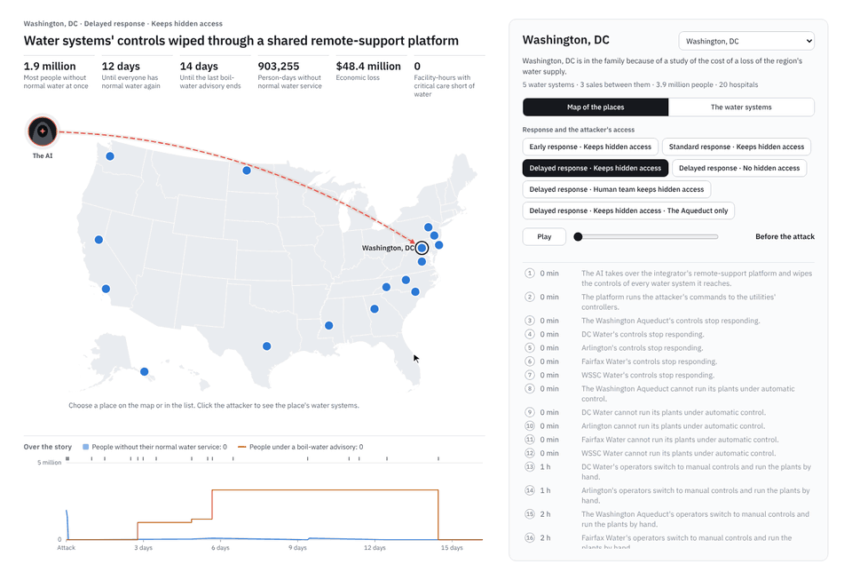

# The live view of the water case



The live view shows one run of one place of the water case. The page has three parts:

- **The header** shows the place, the run and six totals of the run:
  - the most people without normal water at one time;
  - the time until all people have normal water again;
  - the time until the last boil-water advisory ends;
  - the person-days without normal water;
  - the economic loss;
  - the facility-hours with critical care short of water.
- **The main area** shows the map of the 16 places or the water systems of the place. The view of the water
  systems shows one row for each system. The row shows what its plants can make, what it buys and its
  stored water. It also shows the mode of the system, its homes and its hospitals. The lines on the left
  show the sales between the systems. The chart below shows the people without normal water and the
  people under a boil-water advisory.
- **The panel on the right** selects the place, the view and the response. The slider sets the time, and
  **Play** moves the time through the story. The list shows the moments of the run, in the words of the
  model.

Each number and each word comes from the model of the place, from its evidence or from the record of the
run. The page calculates nothing. The view does not change the model. To change an input, use the model
and the edit tools of napkin.

## Start the live view

You need the Python environment of the repository and Node.js 20 or later. Do these steps at the root of
the checkout:

1. Install the packages of the page:

   ```sh
   python -B -m scenarios.water_controls_wipe.ui setup
   ```

2. Build the page if it changed, and start the server:

   ```sh
   python -B -m scenarios.water_controls_wipe.ui serve
   ```

3. Open [the live view](http://localhost:8765/).

The server answers only on this computer. `--port` sets its port. `--jobs` sets the number of worker
processes. Each worker compiles a place one time. The server calculates a run when the page asks for it.
A run that the run store holds comes back immediately. A run that stops shows its failure message.

Other commands:

- `dev` serves the page with live reload.
- `test` runs the unit tests of the page.

## Local API

| GET route | Result |
| --- | --- |
| `/api/places` | The places, with their number of systems, people and hospitals |
| `/api/places/{place}` | The systems, the sales between them, the hospitals, the runs and the words of the outputs |
| `/api/places/{place}/runs/{run}` | The totals, the moments and the series of the run until its story ends |

The story of a run ends when the service, the advisories and the controls of each system are stable. The
series stop at that time, and the totals are the values at the horizon. The state "Before the attack"
is not in the record: the view shows the values that the model declares at the start, with full stores
and the normal use.
